# Hermetic Release Workflow: Local Dependency Redirection for Argo UI

This document explains how this repository builds the Argo CD and Argo
Rollouts web UIs inside **hermetic** (network-isolated) Konflux container
builds, even though their upstream `package.json` pins the `argo-ui`
package directly from a GitHub commit instead of an npm registry release.

## Table of Contents

- [1. Why this exists](#1-why-this-exists)
- [2. Overview](#2-overview)
- [3. End-to-end flow diagram](#3-end-to-end-flow-diagram)
- [4. Scripts](#4-scripts)

## 1. Why this exists

Konflux builds this repo's images with `hermetic: true`
(`.tekton/build-multi-platform-image.yaml`): once the `prefetch-dependencies`
task has resolved every dependency declared via `prefetch-input`, the
`buildah` build step that actually runs the `Dockerfile` instructions
executes with **no outbound network access at all**. Any `RUN` step that
tries to reach the internet — `curl`, `go get`, `npm install` against a live
registry, `git clone` of a submodule it doesn't already have — fails.

Both `argo-cd` and `argo-rollouts` vendor their web UI's `argo-ui` dependency
straight from a GitHub commit instead of a registry release:

```json
"argo-ui": "git+https://github.com/argoproj/argo-ui.git#<40-char-sha>"
```

Hermeto/Cachi2 (the prefetch engine Konflux uses) does not fetch arbitrary
git/tarball dependencies on behalf of pnpm, and even if it did, the fetch
would have to happen inside the hermetic `buildah` step and would fail.
**The fix is to never let pnpm look at a remote URL for `argo-ui` in the
first place.** Instead:

1. A git submodule (`sources/<product>-ui-ref`) mirrors `argoproj/argo-ui`
   locally, checked out at the exact commit the parent UI's `package.json`
   pins.
2. The `package.json` and `pnpm-lock.yaml` files committed in
   `containers/argocd/ui/` and `clis/kubectl-argo-rollouts/ui/` (the
   "overlay" files) are regenerated from the pristine upstream copies and
   rewritten so the `argo-ui` dependency resolves to a `file:` path pointing
   at that submodule instead of a GitHub URL.
3. Everything in steps 1–2 happens **before** the hermetic build boundary —
   on a developer machine, or in a plain network-enabled pre-merge check —
   and the results are committed to git. Nothing at build time needs the
   network for `argo-ui`.

## 2. Overview

The workflow has two clearly separated parts:

| Phase | When it runs | Network access | Owned by |
|---|---|---|---|
| **Source staging & manifest patching** | Developer machine / `make sources` / pre-merge CI | Yes (GitHub, release assets) | `hack/*.sh` |
| **Hermetic build** | Konflux Tekton pipeline (`prefetch-dependencies` → `buildah`) | Prefetch: yes. Build: **no** | `.tekton/*.yaml`, `Dockerfile` |

Everything produced by the first phase — submodule commits, overlay
`package.json`/`pnpm-lock.yaml` — is **committed to git**. The second phase
only ever reads what's already in the repository; it is not handed anything
at pipeline runtime that wasn't already decided and reviewed as part of a PR
diff.

## 3. End-to-end flow diagram

```mermaid
flowchart TD
    subgraph DEV["Phase 1 — Local Workspace Staging (network allowed)"]
        A["make sources"] --> A1["hack/sync-sources.sh\ngit submodule checkout per config.yaml"]
        A1 --> A2["hack/ui-refs.sh: sync_ui_refs\nCheckout sources/argo-cd-ui-ref and\nsources/argo-rollouts-ui-ref at the\nargo-ui SHA pinned by their parent UI"]
        A2 --> A3["hack/ui-refs.sh: sync_extension_js_refs\nDownload extension .js release assets"]
        A3 --> A4["hack/verify-sources.sh\nAssert commits/refs and *-ui-ref\npins match config.yaml"]
        A4 --> A5["hack/pin-pnpm-deps.sh\nCopy package.json + pnpm-lock.yaml from the\nsubmodule and rewrite argo-ui:\ngit+https://.../argo-ui#sha -> file:../../../sources/*-ui-ref"]
        A5 --> A6["git commit\n(submodule pins + overlay package.json/pnpm-lock.yaml)"]
    end

    subgraph KONFLUX["Phase 2 — Konflux Pipeline (hermetic from prefetch onward)"]
        B1["clone-repository\n(git-clone-oci-ta, recursive submodules)"] --> B2["prefetch-dependencies\ntype=pnpm reads the already-pinned overlay\npackage.json/pnpm-lock.yaml; argo-ui's file:\npath is skipped, all other deps fetched over network"]
        B2 --> B3["build-images (buildah, hermetic=true,\nNO network from here on)"]
        B3 --> C1["Dockerfile: COPY overlay package.json,\noverlay pnpm-lock.yaml, .npmrc,\nand sources/*-ui-ref submodule"]
        C1 --> C2["pnpm install --frozen-lockfile --offline\n(argo-ui resolves to the local submodule\npath; populates node_modules)"]
        C2 --> C3["COPY full sources/*/ui/ tree\n(overwrites package.json + pnpm-lock.yaml\nwith pristine upstream copies; node_modules\nis untouched since it isn't part of that tree)"]
        C3 --> C4["COPY overlay package.json + pnpm-lock.yaml again\n"]
        C4 --> C5["pnpm build (offline)"]
        C5 --> D["Final image: argocd / kubectl-argo-rollouts"]
    end

    A6 -. "git push / PR merge" .-> B1
```


## 4. Scripts

### 4.1 `hack/ui-refs.sh` — source sync library

Sourced (not executed directly) by `sync-sources.sh`, `verify-sources.sh`,
and `update-sources.sh`. Provides:

- `sync_ui_refs` — checks out `sources/argo-cd-ui-ref` and
  `sources/argo-rollouts-ui-ref` at the `argo-ui` commit each parent UI's
  `package.json` pins.
- `verify_ui_refs` — verifies both of those submodules are checked out at
  the commit their parent currently pins; used by `verify-sources.sh` to
  catch drift.
- `sync_extension_js_refs` — downloads prebuilt extension JS assets
  (`extensions-Rollout.js`, `extension-promoter.js`) from GitHub Releases.
  Unrelated to the `argo-ui` pinning described here, but lives in the same
  file since both are source-staging steps.
- Shared helpers (`config_source_field`, `argo_ui_sha`,
  `argo_ui_sha_at_commit`) that read `config.yaml` via `yq` and extract the
  pinned `argo-ui` SHA from a `package.json`, preferring a local read (no
  network) and falling back to GitHub's raw-content API only when the
  target commit isn't checked out locally yet.

### 4.2 `../hack/pin-pnpm-deps.sh` — overlay manifest generator & rewrite engine

Run as part of the `make sources` target. For each product, it regenerates
**both** overlay files Hermeto's `pnpm` prefetch-input reads from
`containers/argocd/ui` or `clis/kubectl-argo-rollouts/ui` — `package.json`
and `pnpm-lock.yaml` — from the pristine copies checked out in the
corresponding `sources/<product>/ui/` submodule, then rewrites the
`argo-ui` reference in each to a local `file:` path. It holds both the
`argo-ui` URL matching patterns and the rewrite logic that acts on them,
and is the only place that needs to rewrite the `argo-ui` reference

It defines:

- `ARGO_UI_GIT_SPEC_PATTERN` / `ARGO_UI_TARBALL_PATTERN` (`readonly`) — the
  two regexes that identify a remote `argo-ui` reference: the
  `git+https://github.com/argoproj/argo-ui.git#<sha>` dependency spec and
  the `https://codeload.github.com/argoproj/argo-ui/tar.gz/<sha>` tarball
  URL pnpm resolves it to. Both require exactly 40 hex characters
  (`[0-9a-f]{40}`), matching a real git SHA.
- `pin_ui_deps_to_local_file(file, file_spec)` — patches `file` in place,
  replacing any of the above patterns (plus the `resolution: {...}` block
  built from the tarball pattern) with `file_spec`. Idempotent: if `file`
  already contains `file_spec`, it's a no-op. Validates that at least one
  remote pattern is present before writing, and rewrites atomically via a
  same-directory `mktemp` + `mv` (never a bare `sed ... "$file" > "$file"`,
  which would truncate the file before `sed` finishes reading it).
- `stage_overlay_file(src, dst, file_spec)` copies `src` → `dst` (deleting
  `dst` first so it never writes back through a symlink into the submodule),
  then rewrites the `argo-ui` reference in `dst` to the local `file:` path
  via `pin_ui_deps_to_local_file`.

Both overlay files are fully regenerated and committed to git. They are
consumed by Hermeto (`prefetch-dependencies`) and copied directly into the
Dockerfile build.

